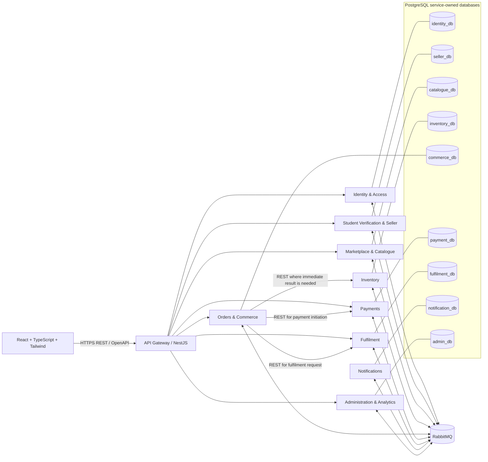

# SokoLink architecture

## Context and goals

SokoLink serves customers and student sellers through a marketplace plus business operations. It must begin with a manageable operating footprint and allow independently deployed domains to scale or evolve without shared-table coupling. The architecture favors clear ownership, operational visibility, security and incremental delivery over maximizing service count.

## System view

The diagram represents target logical boundaries. The Stage 4 foundation currently creates independently runnable gateway, identity, seller, catalogue, inventory, commerce, payment, fulfilment and notification apps. Administration starts as a protected interface over service APIs/events; it does not gain cross-database read access. Analytics uses projections built from events. The gateway currently has only ingress bootstrap, health and OpenAPI scaffolding; proxy routing, authentication enforcement and rate limiting remain to implement.

## Service topology and contracts

Services expose versioned REST APIs described using OpenAPI. The gateway is the public ingress and handles request correlation, routing, coarse rate limiting, CORS and token verification; each service still authenticates and authorizes the caller for its own resource. Internal REST is reserved for decisions needed in the current request. Events carry facts and are consumed asynchronously. No service accesses another service's database.

RabbitMQ is the initial broker because the expected workflows are task/event delivery, not an analytical event log. Use durable exchanges/queues, persistent messages, publisher confirms, manual consumer acknowledgements, bounded retries, dead-letter handling and idempotent consumers. Outbox records are committed with local state and published asynchronously. Delivery is at least once; consumers deduplicate by event ID. Broker loss must not lose committed business events.

## Data and consistency

Each service owns a PostgreSQL database/schema boundary and migrations. Separate databases/credentials are used even when a single PostgreSQL container hosts them in development. Cross-domain views are local projections updated from events, with freshness indicated where needed. A checkout/order flow is a saga: reserve stock, create payment intent, await provider-confirmed result, confirm or release reservations, then arrange fulfilment. Compensating actions and timeout/reconciliation paths handle partial failure. Payment and order endpoints accept idempotency keys; provider callbacks are independently deduplicated.

## Identity and authorization

One account can hold CUSTOMER access and later apply for SELLER eligibility. Approval is a reviewed state transition; it grants seller permissions without another identity. Roles are coarse grants, with permissions scoped to actions/resources and enforced server-side. Access tokens are short-lived; refresh tokens are rotated, stored hashed, and revocable. Seller approval, role changes, payment transitions and administrative decisions are audited.

## Deployment and scaling

Docker Compose defines local PostgreSQL, RabbitMQ, gateway, services and web app. Runtime verification remains pending because this implementation environment cannot access the npm registry or create the Podman user namespace. Production deploys each service/image independently behind an ingress/load balancer, with managed PostgreSQL or isolated databases, managed broker, secret manager, TLS, backups and centralized metrics/logs/traces. Stateless API replicas scale horizontally; consumers scale by queue and partitioning constraints. Start with a modest deployment topology and add clustering/managed infrastructure when availability and throughput requirements justify cost.

## Observability and operations

Propagate W3C trace context and a request/correlation ID through HTTP and message headers. Emit structured logs without passwords, tokens, payment credentials or unnecessary student documents. Track API latency/error rates, queue depth/age, consumer failures, payment pending age, outbox backlog, and database health. Readiness checks require essential dependencies; liveness checks avoid cascading restarts. Define retention, backup and recovery objectives before production.

## Monorepo choice

Use Nx with TypeScript project references, tagged project boundaries, affected builds/tests and shared lint/build conventions. Nx supports NestJS projects and boundary enforcement; those capabilities are useful when a repository contains several deployable services and a frontend. Nx adds toolchain and configuration overhead, so keep application ownership explicit, avoid giant shared libraries, and permit sharing only for stable infrastructure/contracts. ADR-001 records the choice.

## Important trade-offs and unresolved decisions

- More service boundaries improve ownership and scaling but increase deployment, observability and local development cost. Begin with the bounded service set described above and split only on operational or team ownership needs.
- PostgreSQL-per-service has more migrations and connections than one shared schema; it prevents accidental coupling and supports independent evolution.
- RabbitMQ suits command/event workflows; if replayable event history, high-volume streams or analytics become primary, reassess rather than treating RabbitMQ as a data lake.
- We need product decisions on marketplace commission/settlement, seller payout timing, cancellation/refund policy, delivery pricing/ownership, student data retention and launch scope before implementing those flows.
- Provider onboarding and sandbox access must be validated with each Tanzania operator before choosing a first live payment integration.
