# SokoLink Database ERD

| Attribute | Value |
| --- | --- |
| Product | SokoLink |
| Document | Database Entity Relationship Design |
| Version | Draft 1.0 |
| Date | 2026-11-17 |
| Requirements baseline | SokoLink SRS Draft 1.0 |
| Architecture | Database per service |
| Status | Draft for engineering approval |

## 1. Purpose and reading guide

This document is the logical and physical database design baseline for SokoLink. It covers:

1. The schemas implemented today.
2. The target MVP schema required by the SRS and the approved business decisions.
3. Cross-service reference rules where no database foreign key can exist.
4. Constraints, state values and migration notes.

**Implementation status legend**

- **Current**: exists in the repository today.
- **Planned**: required by the target design but not yet implemented.
- **Transitional**: current field or table that must be migrated, split or replaced.

No service may query another service's database. Identifiers such as `userId`, `sellerId`, `productId` and `orderId` are logical references only. Cross-service consistency is maintained through APIs, events, snapshots and reconciliation.

## 2. Ownership map

| Database | Service | Authoritative for |
| --- | --- | --- |
| `identity_db` | Identity and Access | Accounts, credentials, sessions, roles, permissions, verification, authentication audit, identity outbox |
| `seller_db` | Seller and Verification | Seller applications, IFM evidence, review outcomes, storefronts, seller status history |
| `catalogue_db` | Catalogue | Categories, products, variants, images, specifications, moderation history, public rating projection |
| `inventory_db` | Inventory | Stock levels, reservations, stock movements, reconciliation |
| `commerce_db` | Commerce and Orders | Carts, checkout sagas, parent orders, seller orders, order items, order status history, reviews, disputes |
| `payment_db` | Payment | Payment methods, payment records, provider transactions, callbacks, refunds, ledger, settlements |
| `fulfilment_db` | Fulfilment | Pickup points, fulfilment jobs, status events, proof of delivery, delivery assignments |
| `notifications_db` | Notifications | Templates, notifications, preferences, delivery attempts, inbox events |
| `admin_db` | Administration and Analytics | Non-authoritative projections for audit search, moderation queues and reporting |

Service-owned databases are isolated. `admin_db` is a read-model store and is never authoritative for orders, payments, stock or access control.

## 3. Shared conventions

- Primary keys are UUIDv4 stored as PostgreSQL `uuid`.
- Timestamps are `timestamptz(3)`; all persisted times are UTC.
- Money is integer TZS shillings for the MVP. `currency` is stored alongside money where needed.
- Quantities are positive integers; stock and money columns have non-negative checks where applicable.
- Mutable business tables carry `created_at` and `updated_at`.
- Immutable history tables are append-only: `stock_movement`, `order_status_history`, `audit_log`, `payment_transaction`, `payment_callback`, `fulfilment_event`, `settlement_item`.
- Soft deletion is not a substitute for an order or payment state. Archived products use `ARCHIVED`; disabled users use `DISABLED`.
- Every service that publishes events owns an `outbox_event` table. Every service that consumes events owns an `inbox_event` table.
- Request-level idempotency is stored by the service that performs the mutation: checkout in Commerce, payment initiation/callback in Payment, role grant in Identity.

### 3.1 Shared infrastructure tables

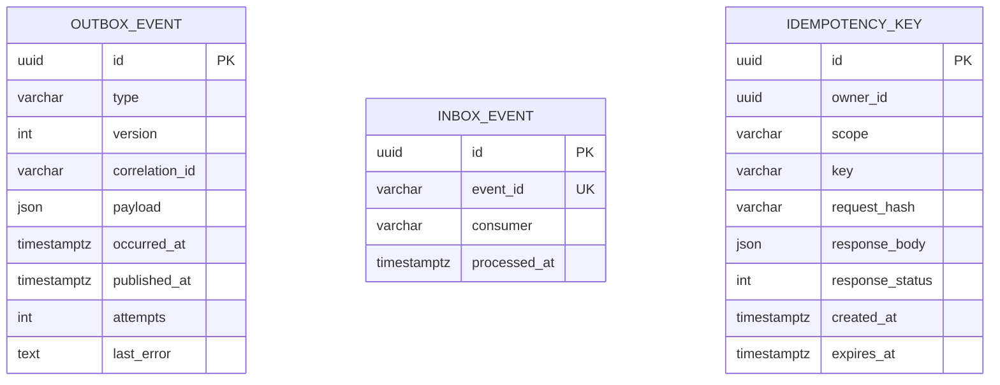

`outbox_event` exists today in Identity. It must be added to every event-producing service. `inbox_event` and `idempotency_key` are planned. `idempotency_key` has a unique constraint on `(owner_id, scope, key)` and a retention job.

## 4. Identity and Access ERD

### 4.1 Current identity schema

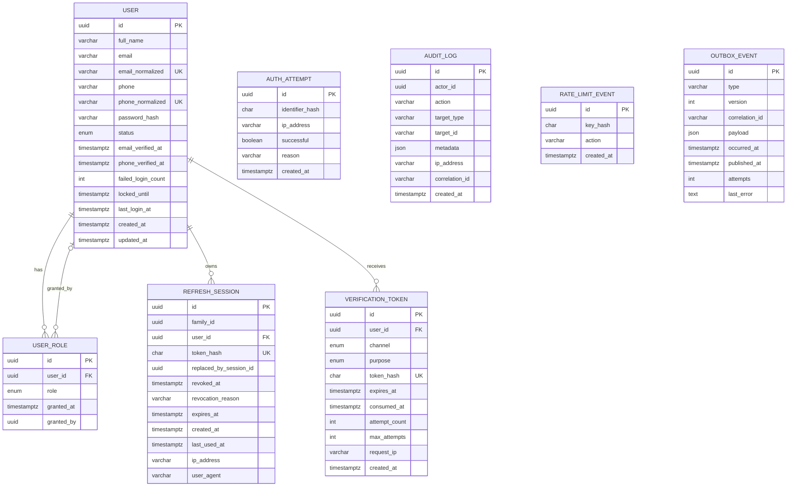

For `channel = EMAIL` and `purpose = REGISTRATION`, `token_hash` stores an HMAC of the verification-record ID and the six-digit OTP. Issuing a new OTP invalidates the outstanding record; verification increments `attempt_count`, allows at most five attempts, and atomically claims the record on success. Password-reset records continue to store a hash of an opaque random token.

### 4.2 Target identity additions and migration

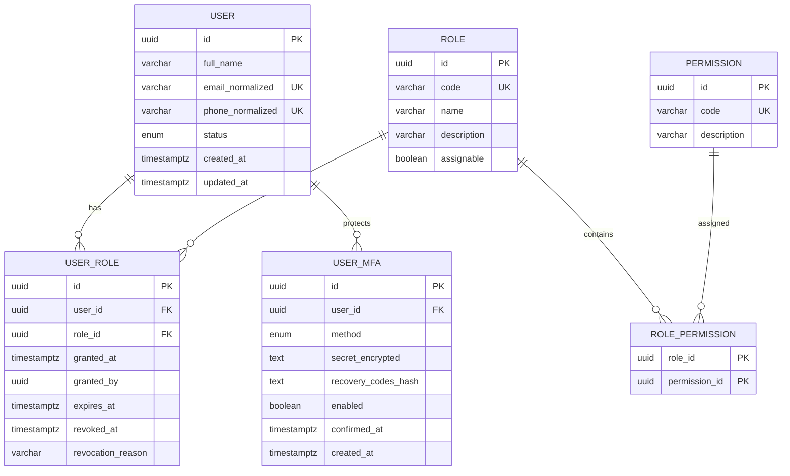

Migration notes:

- `USER_ROLE.role` is currently a `RoleName` enum. The target replaces it with `role_id` plus seeded roles and permissions.
- The legacy enum can remain during a transition, but API authorization should move to permission checks before the column is removed.
- Add explicit `SUPER_ADMIN` separation and permission `platform.superadmin`.
- Roles: `CUSTOMER`, `SELLER`, `DELIVERY_PARTNER`, `ADMIN`, `SUPER_ADMIN`.
- `SELLER` is granted only from the seller approval workflow.
- Add account status history if suspension/disable reasons need long-term reporting.

## 5. Seller and Verification ERD

### 5.1 Current seller schema

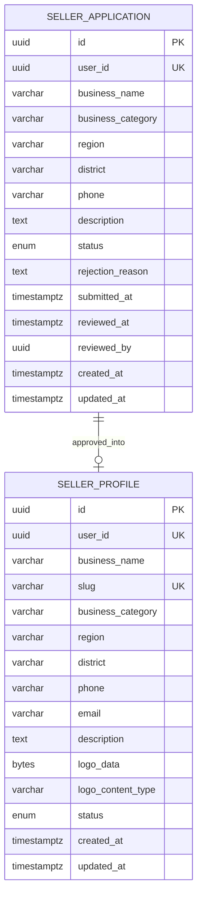

The application-to-profile relationship is logical through `user_id`; the current Prisma schema does not declare a database foreign key between these two tables. Both identifiers are separate from the catalogue `seller_id`, which uses `User.id`.

### 5.2 Target seller additions

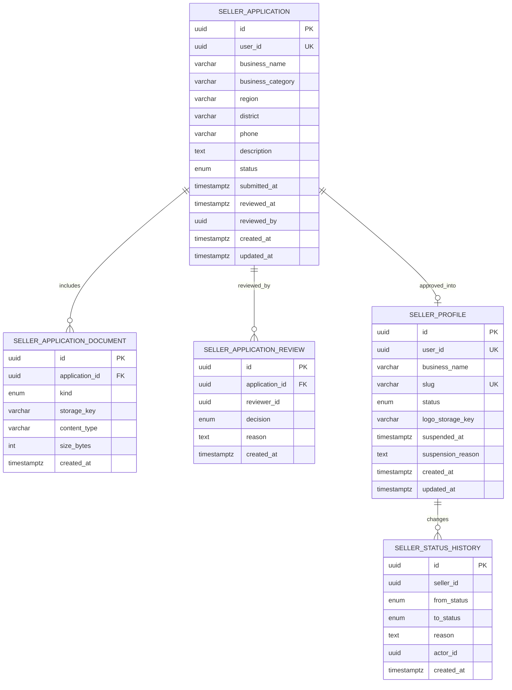

Migration notes:

- Add IFM student evidence as documents, never as unstructured text in `description`.
- `SellerApplicationStatus` target: `DRAFT`, `SUBMITTED`, `UNDER_REVIEW`, `NEEDS_INFORMATION`, `APPROVED`, `REJECTED`, `WITHDRAWN`. Current `PENDING` maps to `SUBMITTED`.
- `StorefrontStatus` target adds `SUSPENDED` alongside `ACTIVE` and `PAUSED`.
- Store `logo_storage_key` in production; the current `logo_data` byte column is transitional.
- Seller identity remains `User.id`; `SELLER_PROFILE.id` is not used as the catalogue `sellerId`.

## 6. Catalogue ERD

### 6.1 Current catalogue schema

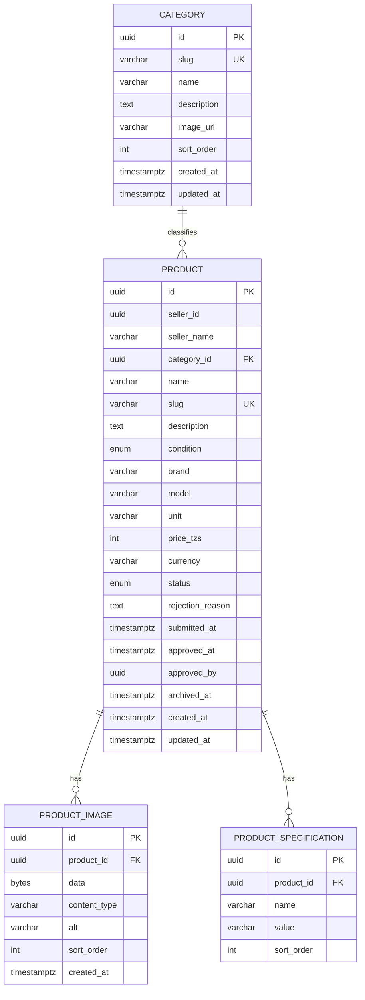

`PRODUCT.seller_id` is the identity user id. `seller_name` is a display snapshot used by public listing and order creation.

### 6.2 Target catalogue additions

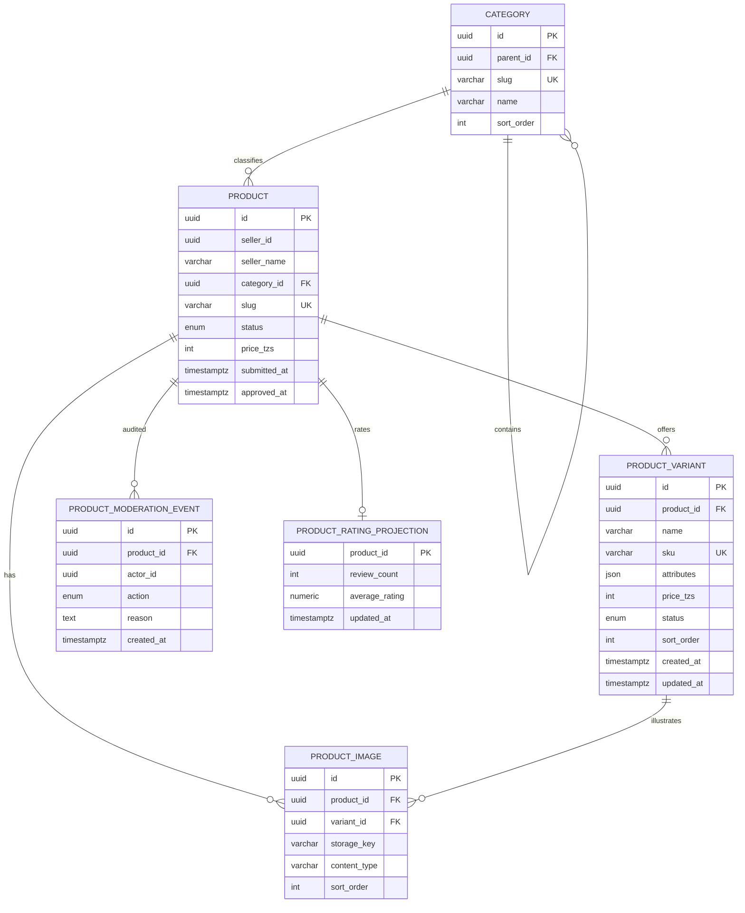

Migration notes:

- `ProductStatus` target: `DRAFT`, `PENDING`, `APPROVED`, `REJECTED`, `ARCHIVED`. Existing values remain valid.
- `ProductCondition`: `NEW`, `USED`, `REFURBISHED`.
- `ProductVariant` is planned because the SRS requires variant/price/availability representation. Products without variants use the base product price and stock item.
- Product images move from `data` bytes to object storage. Keep `data` only for local development until migration is complete; images may target a product or a variant.
- `PRODUCT_RATING_PROJECTION` is updated from `ReviewPublished` events and is non-authoritative.
- A seller with unknown or non-approved status must not be able to create or publish products; catalogue consumers enforce this using seller events.
- `seller_name` is denormalized for listing. When a storefront name changes, a backfill may update display snapshots, but order snapshots remain immutable.

## 7. Inventory ERD

### 7.1 Current inventory schema

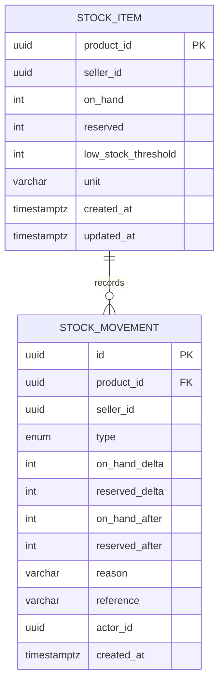

`STOCK_ITEM.product_id` is the catalogue product id. `seller_id` is the identity user id. There is no cross-database foreign key.

### 7.2 Target inventory additions

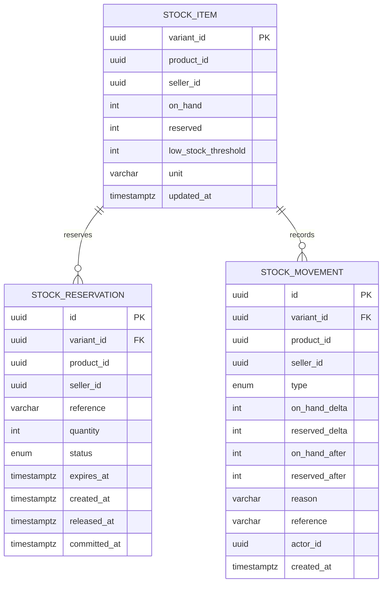

Migration notes:

- `StockReservation` enables expiry, explicit state and reconciliation. Current reservations are inferred from `StockMovement` rows with `reference`.
- Stock is keyed by `variant_id` in the target. Current stock is keyed by `product_id`; migrate each product's stock to its default variant.
- Unique `(reference, variant_id)` prevents duplicate reservation lines.
- `reference` is the commerce order or checkout reference.
- Add `CHECK (on_hand >= 0 AND reserved >= 0 AND reserved <= on_hand)`.
- Add a job that expires stale `PENDING` reservations and posts `RELEASE` movements.
- Movement types: `OPENING`, `ADJUSTMENT`, `RESERVATION`, `RELEASE`, `FULFILMENT`.

## 8. Commerce and Orders ERD

### 8.1 Current commerce schema

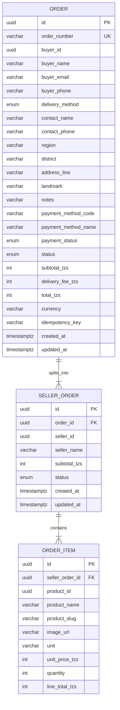

Constraints:

- `ORDER.order_number` unique.
- `ORDER(buyer_id, idempotency_key)` unique.
- `SELLER_ORDER(order_id, seller_id)` should be unique.
- `ORDER_ITEM.quantity > 0`, `unit_price_tzs >= 0`, `line_total_tzs = unit_price_tzs * quantity`.
- `ORDER.total_tzs = subtotal_tzs + delivery_fee_tzs`.

### 8.2 Target commerce additions

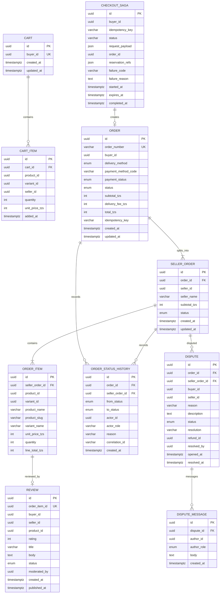

Migration notes:

- Current `OrderStatus`: `PLACED`, `CONFIRMED`, `PROCESSING`, `SHIPPED`, `DELIVERED`, `CANCELLED`.
- Target order/seller-order statuses add: `PENDING_PAYMENT`, `PAID`, `READY_FOR_PICKUP`, `READY_FOR_DELIVERY`, `OUT_FOR_DELIVERY`, `COMPLETED`, `REJECTED`, `REFUND_PENDING`, `REFUNDED`, `DISPUTED`.
- Map old `SHIPPED` to `OUT_FOR_DELIVERY` or keep as a compatibility value until migration.
- `OrderItem.variant_id` and `variant_name` are snapshots for products with variants; products without variants use the default variant or no variant.
- Current `PaymentStatus` in Commerce is a snapshot; Payment is authoritative. A reconciliation job compares both.
- `Review` requires a delivered `OrderItem`, one per item, rating 1-5.
- `Dispute` links to a Payment refund by `refund_id`; the reference is logical across databases.
- `CHECKOUT_SAGA` is the target owner of checkout idempotency and compensation state. It is distinct from the order idempotency key, although both should be correlated.

## 9. Payment ERD

### 9.1 Current payment schema

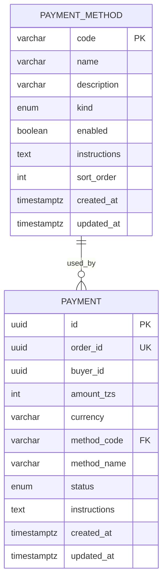

`PAYMENT.order_id` is the commerce order id. `buyer_id` is the identity user id. There is no cross-database foreign key.

### 9.2 Target payment additions

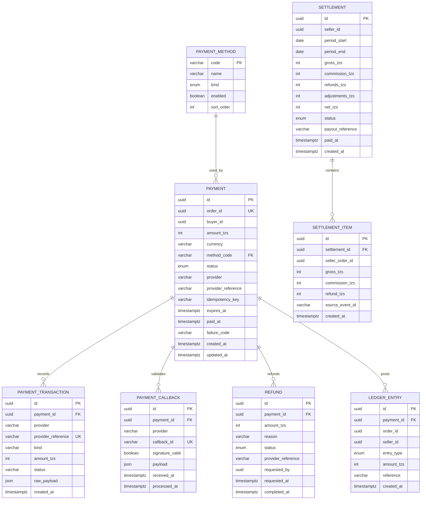

Constraints and rules:

- `PAYMENT.order_id` unique; one active payment per parent order.
- `PAYMENT_TRANSACTION(provider, provider_reference)` unique.
- `PAYMENT_CALLBACK(provider, callback_id)` unique.
- `REFUND` total per payment must not exceed successful captured amount minus prior refunds.
- `SETTLEMENT_ITEM.seller_order_id` unique to prevent double settlement.
- `SETTLEMENT.net_tzs = gross_tzs - commission_tzs - refunds_tzs + adjustments_tzs`.
- `LEDGER_ENTRY` is append-only. Corrections are new entries, never edits.
- Mobile-money methods: `MOBILE_MONEY` kind; cash on delivery: `CASH` kind, code `CASH_ON_DELIVERY`.
- No frontend redirect is authoritative. Only `PAYMENT_CALLBACK`/provider query or authorized COD confirmation can produce `PAID`.
- Settlements are per seller and period, generated only after eligible orders are delivered and the refund window is closed.

## 10. Fulfilment ERD

The current service has no domain tables. The following is the planned MVP schema.

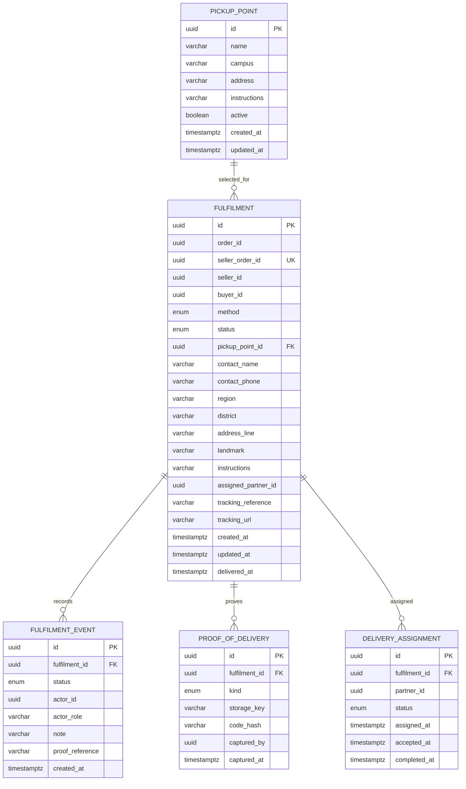

Rules:

- `FULFILMENT.seller_order_id` unique; one fulfilment job per seller order.
- `method`: `PICKUP`, `SELLER_DELIVERY`; `PARTNER_DELIVERY` is deferred.
- Target statuses: `PENDING`, `READY`, `AWAITING_HANDOVER`, `OUT_FOR_DELIVERY`, `DELIVERED`, `FAILED`, `CANCELLED`.
- Pickup requires a `pickup_point_id`; seller delivery requires address fields.
- Delivery partner access is limited to assigned `DELIVERY_ASSIGNMENT` rows.
- Proof may be a code hash, photo storage key or signed recipient confirmation. Store no unnecessary personal data.
- `tracking_reference` and `tracking_url` support an external carrier when seller delivery uses one; live GPS tracking is out of scope.
- `order_id` and `seller_order_id` are logical references to Commerce. `seller_id`, `buyer_id` and `assigned_partner_id` are logical references to Identity.

## 11. Notifications ERD

The current service has no domain tables. The following is the planned MVP schema.

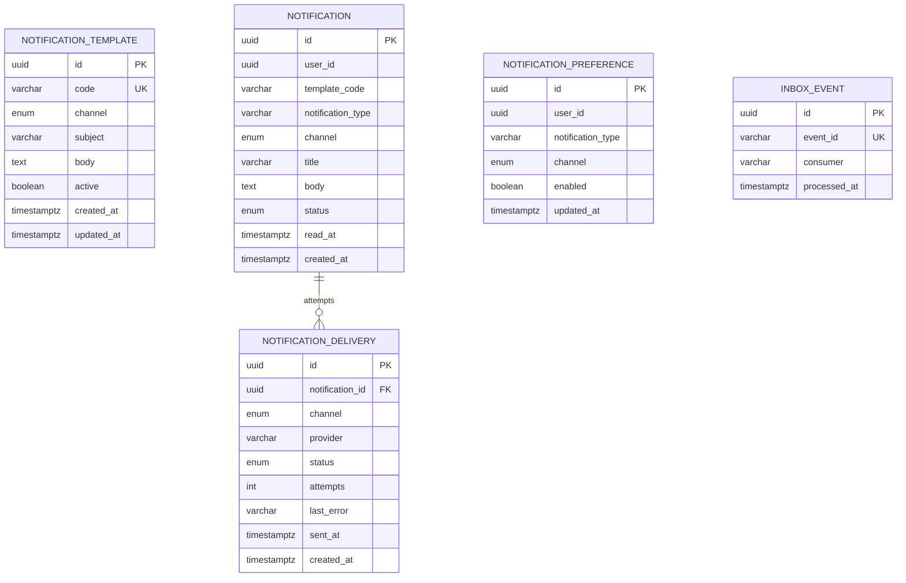

Rules:

- `NOTIFICATION_PREFERENCE(user_id, notification_type, channel)` unique.
- `INBOX_EVENT.event_id` unique per consumer.
- Preferences cannot disable mandatory security or transactional notices unless policy allows it.
- Notifications are derived event data and never authoritative for order/payment state.
- `channel`: `EMAIL`, `IN_APP`, `SMS`.
- `status`: `QUEUED`, `SENT`, `FAILED`, `READ`.

## 12. Administration and analytics projections

There is no authoritative admin database in the MVP. Administration calls owning-service APIs. The following `admin_db` projections are planned and non-authoritative.

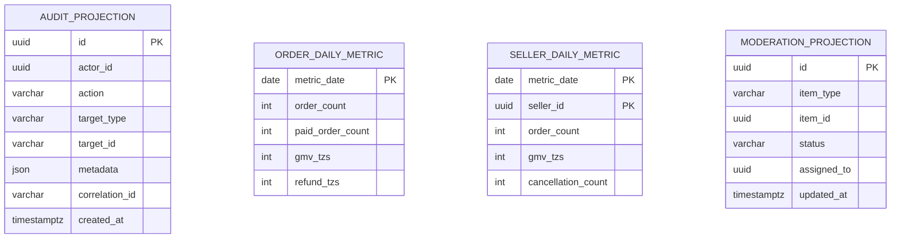

Rules:

- Projections can be rebuilt from events and owning-service APIs.
- They must never be used to authorize users or mutate orders/payments.
- Audit projections contain metadata only; secrets and student evidence are excluded.

## 13. Cross-service reference map

| Source | Field | Target owner | Rule |
| --- | --- | --- | --- |
| `seller_db.SellerApplication.user_id` | `userId` | Identity `User.id` | Unique; validates account before application |
| `seller_db.SellerProfile.user_id` | `userId` | Identity `User.id` | Unique; seller capability is granted in Identity |
| `catalogue_db.Product.seller_id` | `sellerId` | Identity `User.id` | Must correspond to an approved seller |
| `catalogue_db.Product.category_id` | `categoryId` | Catalogue `Category.id` | Local FK |
| `catalogue_db.ProductVariant.product_id` | `productId` | Catalogue `Product.id` | Local FK |
| `inventory_db.StockItem.variant_id` | `variantId` | Catalogue `ProductVariant.id` | Opening stock after variant creation; default variant for simple products |
| `inventory_db.StockItem.product_id` | `productId` | Catalogue `Product.id` | Denormalized for seller reporting |
| `inventory_db.StockItem.seller_id` | `sellerId` | Identity `User.id` | Must match the product seller |
| `commerce_db.Order.buyer_id` | `buyerId` | Identity `User.id` | Authenticated buyer |
| `commerce_db.SellerOrder.seller_id` | `sellerId` | Identity `User.id` | One seller order per seller per parent order |
| `commerce_db.OrderItem.product_id` | `productId` | Catalogue `Product.id` | Product snapshot is immutable |
| `commerce_db.OrderItem.variant_id` | `variantId` | Catalogue `ProductVariant.id` | Variant snapshot is immutable |
| `commerce_db.Review.product_id` | `productId` | Catalogue `Product.id` | Projected into catalogue rating |
| `payment_db.Payment.order_id` | `orderId` | Commerce `Order.id` | Unique; one active payment per order |
| `payment_db.Payment.buyer_id` | `buyerId` | Identity `User.id` | Must match order buyer |
| `payment_db.Payment.method_code` | `methodCode` | Payment `PaymentMethod.code` | Local FK |
| `payment_db.SettlementItem.seller_order_id` | `sellerOrderId` | Commerce `SellerOrder.id` | Unique settlement per seller order |
| `payment_db.Settlement.seller_id` | `sellerId` | Identity `User.id` | Seller payout owner |
| `fulfilment_db.Fulfilment.order_id` | `orderId` | Commerce `Order.id` | Logical reference |
| `fulfilment_db.Fulfilment.seller_order_id` | `sellerOrderId` | Commerce `SellerOrder.id` | Unique |
| `fulfilment_db.Fulfilment.assigned_partner_id` | `assignedPartnerId` | Identity `User.id` | Partner role required |
| `notifications_db.Notification.user_id` | `userId` | Identity `User.id` | Recipient |
| `notifications_db.*.event_id` | `eventId` | Event envelope `id` | Deduplicated per consumer |

Snapshots are deliberate: `sellerName`, `productName`, `productSlug`, `variantName`, `imageUrl`, buyer contact details and prices are copied into orders so later changes do not rewrite history.

## 14. Enumerations and state values

| Enum | Values | Notes |
| --- | --- | --- |
| `UserStatus` | `PENDING_VERIFICATION`, `ACTIVE`, `SUSPENDED`, `DISABLED` | Existing |
| `RoleName` / role code | `CUSTOMER`, `SELLER`, `DELIVERY_PARTNER`, `ADMIN`, `SUPER_ADMIN` | Target normalizes grants through `Role`/`Permission` |
| `VerificationChannel` | `EMAIL`, `PHONE` | Existing |
| `VerificationPurpose` | `REGISTRATION`, `PASSWORD_RESET` | Existing |
| `MfaMethod` | `TOTP`, `RECOVERY_CODE` | Planned |
| `SellerApplicationStatus` | `DRAFT`, `SUBMITTED`, `UNDER_REVIEW`, `NEEDS_INFORMATION`, `APPROVED`, `REJECTED`, `WITHDRAWN` | Target; current `PENDING` maps to `SUBMITTED` |
| `StorefrontStatus` | `ACTIVE`, `PAUSED`, `SUSPENDED` | `SUSPENDED` planned |
| `SellerDocumentKind` | `IFM_STUDENT_ID`, `ENROLMENT_LETTER`, `OTHER` | Planned |
| `ProductStatus` | `DRAFT`, `PENDING`, `APPROVED`, `REJECTED`, `ARCHIVED` | Existing |
| `ProductCondition` | `NEW`, `USED`, `REFURBISHED` | Existing |
| `ProductVariantStatus` | `ACTIVE`, `INACTIVE`, `ARCHIVED` | Planned |
| `MovementType` | `OPENING`, `ADJUSTMENT`, `RESERVATION`, `RELEASE`, `FULFILMENT` | Existing |
| `ReservationStatus` | `PENDING`, `RELEASED`, `COMMITTED`, `EXPIRED` | Planned |
| `OrderStatus` (current) | `PLACED`, `CONFIRMED`, `PROCESSING`, `SHIPPED`, `DELIVERED`, `CANCELLED` | Transitional |
| `OrderStatus` (target) | `PENDING_PAYMENT`, `PAID`, `PROCESSING`, `READY_FOR_PICKUP`, `READY_FOR_DELIVERY`, `OUT_FOR_DELIVERY`, `DELIVERED`, `COMPLETED`, `REJECTED`, `CANCELLED`, `REFUND_PENDING`, `REFUNDED`, `DISPUTED` | Target |
| `PaymentStatus` (commerce snapshot) | `PENDING`, `PENDING_CONFIRMATION`, `PAID`, `FAILED`, `REFUNDED` | Snapshot only |
| `DeliveryMethod` | `PICKUP`, `SELLER_DELIVERY`, `PARTNER_DELIVERY` | Partner deferred |
| `PaymentMethodKind` | `CASH`, `MOBILE_MONEY`, `BANK_TRANSFER`, `CARD` | MVP enables cash and approved mobile money |
| `PaymentRecordStatus` | `INITIATED`, `PENDING`, `SUCCESSFUL`, `FAILED`, `CANCELLED`, `REFUND_PENDING`, `REFUNDED` | Target; current is a subset |
| `PaymentTransactionKind` | `CHARGE`, `REFUND`, `ADJUSTMENT` | Planned |
| `RefundStatus` | `REQUESTED`, `PROCESSING`, `COMPLETED`, `FAILED` | Planned |
| `SettlementStatus` | `DRAFT`, `APPROVED`, `PAID`, `FAILED` | Planned |
| `ReviewStatus` | `PENDING`, `PUBLISHED`, `HIDDEN`, `REJECTED` | Planned |
| `DisputeStatus` | `OPEN`, `SELLER_RESPONDED`, `UNDER_REVIEW`, `RESOLVED`, `CLOSED` | Planned |
| `FulfilmentMethod` | `PICKUP`, `SELLER_DELIVERY`, `PARTNER_DELIVERY` | Partner deferred |
| `FulfilmentStatus` | `PENDING`, `READY`, `AWAITING_HANDOVER`, `OUT_FOR_DELIVERY`, `DELIVERED`, `FAILED`, `CANCELLED` | Planned |
| `NotificationChannel` | `EMAIL`, `IN_APP`, `SMS` | Planned |
| `NotificationStatus` | `QUEUED`, `SENT`, `FAILED`, `READ` | Planned |

## 15. Critical constraints and indexes

### 15.1 Identity

- `users.email_normalized` unique; `users.phone_normalized` unique.
- `user_roles(user_id, role_id)` unique after migration; current `(user_id, role)` unique.
- `refresh_sessions.token_hash` unique; index `(family_id)`, `(user_id, expires_at)`.
- `verification_tokens.token_hash` unique; index `(user_id, channel, purpose, created_at)`.
- `auth_attempts(identifier_hash, created_at)` and `(ip_address, created_at)` for abuse detection.
- `outbox_event(published_at, occurred_at)` for polling.

### 15.2 Seller and catalogue

- `seller_applications.user_id` unique.
- `seller_profiles.user_id` unique; `seller_profiles.slug` unique.
- `products.slug` unique.
- `product_variants.sku` unique; `product_variants(product_id, sort_order)`.
- `products(status, created_at)`, `products(category_id, status)`, `products(seller_id, status)`, `products(price_tzs)`.
- `product_images(product_id, sort_order)`, `product_images(variant_id, sort_order)`.
- `product_specifications(product_id, sort_order)`.
- `seller_applications(status, submitted_at)`.

### 15.3 Inventory and commerce

- `stock_items.variant_id` primary key; `CHECK (on_hand >= 0)`, `CHECK (reserved >= 0)`, `CHECK (reserved <= on_hand)`.
- `stock_reservations(reference, variant_id)` unique; index `(status, expires_at)`.
- `stock_movements(variant_id, created_at)`, `(seller_id, created_at)`.
- `orders.order_number` unique; `(buyer_id, idempotency_key)` unique.
- `seller_orders(order_id, seller_id)` unique.
- `order_items(seller_order_id)`, `(product_id)`, `(variant_id)`.
- `reviews.order_item_id` unique; `CHECK (rating BETWEEN 1 AND 5)`.
- `checkout_sagas(buyer_id, idempotency_key)` unique.
- `order_status_history(order_id, created_at)`.

### 15.4 Payment, fulfilment and notifications

- `payments.order_id` unique; `payments(status, created_at)`.
- `payment_transactions(provider, provider_reference)` unique.
- `payment_callbacks(provider, callback_id)` unique.
- `refunds.payment_id` indexed; sum of completed refunds must not exceed captured amount.
- `settlement_items.seller_order_id` unique; `settlements(seller_id, period_start, period_end)` unique.
- `fulfilments.seller_order_id` unique; `fulfilment_events(fulfilment_id, created_at)`.
- `proof_of_delivery(fulfilment_id)` indexed.
- `notification_preferences(user_id, notification_type, channel)` unique.
- `notification_deliveries(notification_id, created_at)`.
- `inbox_events(event_id, consumer)` unique.

## 16. Migration path from current to target

| Step | Change | Risk control |
| --- | --- | --- |
| 1 | Add target enums/columns alongside current fields | Backward-compatible migrations; no destructive rename |
| 2 | Normalize Identity roles/permissions | Seed roles; dual-read old enum/new roles; then cut over |
| 3 | Add seller documents/reviews/status history | Backfill existing approved applications; preserve current decisions |
| 4 | Add product variants and default-variant backfill | Create one default variant per existing product; map stock and order items |
| 5 | Move images/logo to object storage | Dual-write or copy; keep byte fallback until verified |
| 6 | Add stock reservations and expiry job | Backfill from open order references; reconcile before enabling |
| 7 | Add server cart and checkout saga | Keep local cart until server cart is proven; checkout revalidates |
| 8 | Expand order statuses and add history | Map current statuses; preserve existing rows with compatibility values |
| 9 | Add reviews/disputes | Enable only for delivered orders; add moderation queue |
| 10 | Add payment provider transactions/callbacks/refunds | Test sandbox callbacks; block live until signature and replay tests pass |
| 11 | Add settlements/ledger | Generate in dry-run; reconcile against orders/refunds before payouts |
| 12 | Implement fulfilment | Start with pickup and seller delivery; defer partner assignment |
| 13 | Implement notifications | Consume events with inbox dedupe; keep mandatory notices |
| 14 | Add admin projections | Rebuild from events; never write back to owning services |

Every migration must be forward-only and reviewed against existing seeded/demo data. No service may migrate another service's database.

## 17. Data protection and retention notes

- Student evidence is sensitive: restrict access to seller reviewers and authorized admins; redact from logs and events.
- Store only the minimum buyer/seller contact data needed to fulfil orders.
- Audit and financial records have longer retention than marketing preferences.
- Define retention for authentication attempts, rate-limit events, verification tokens, notifications and student evidence before production.
- Provide account deletion/anonymization design that preserves legally required order and financial records without retaining unnecessary personal data.
- Backups are encrypted and access-controlled; restore access is audited.

## 18. ERD review checklist

- Every table belongs to exactly one owning service.
- Every cross-service reference is documented and has no database FK.
- Every mutable business table has a clear lifecycle.
- Every money/quantity column has validation and precision rules.
- Every event has an outbox/inbox dedupe strategy.
- Every order, payment, refund and settlement has an immutable audit trail.
- Every seller, buyer, delivery and admin access path has an ownership rule.
- Current-to-target migrations have a rollback or compatibility plan.
- Student evidence and personal data have restricted access and retention rules.
- No frontend-only control is treated as an authorization boundary.
