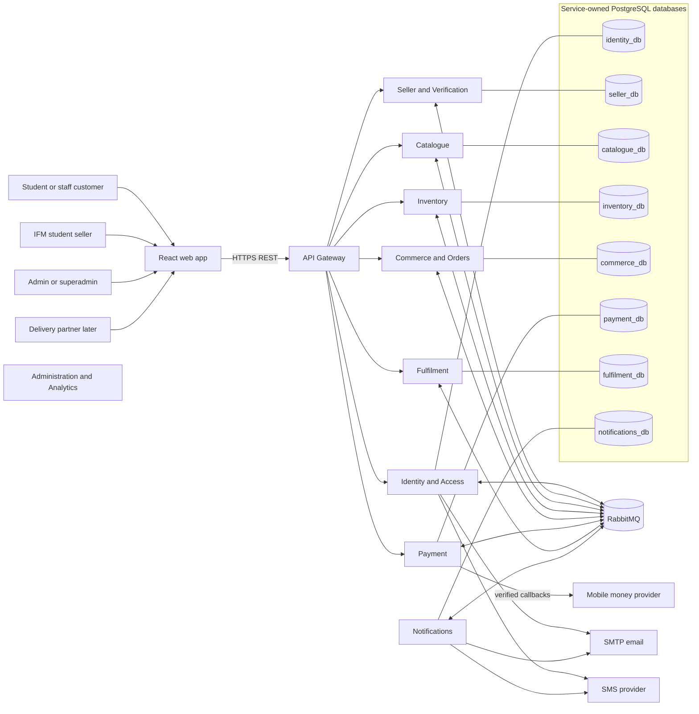
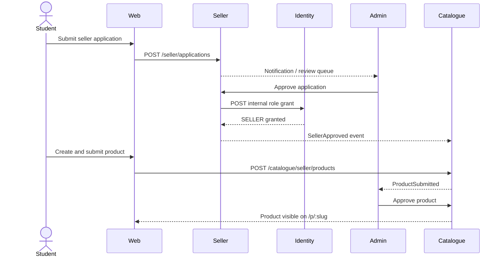
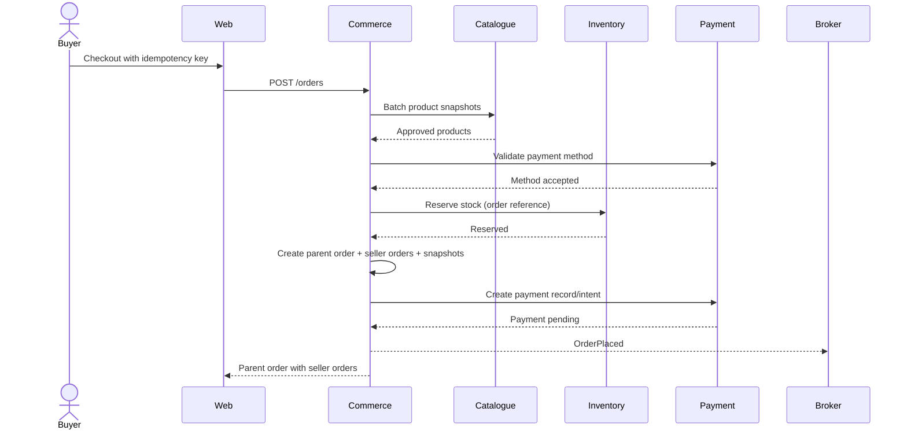
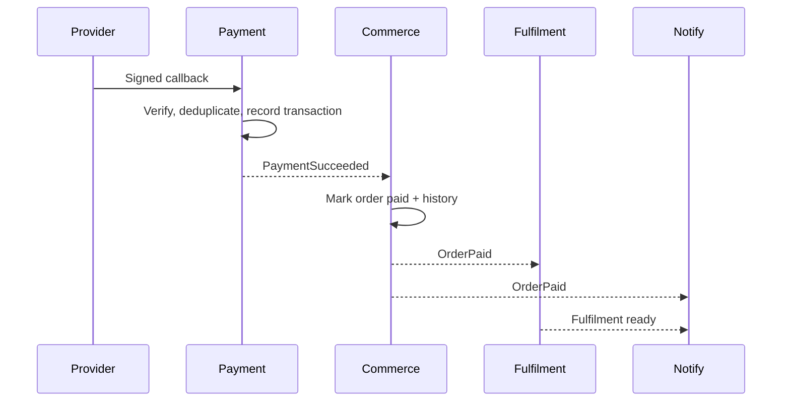
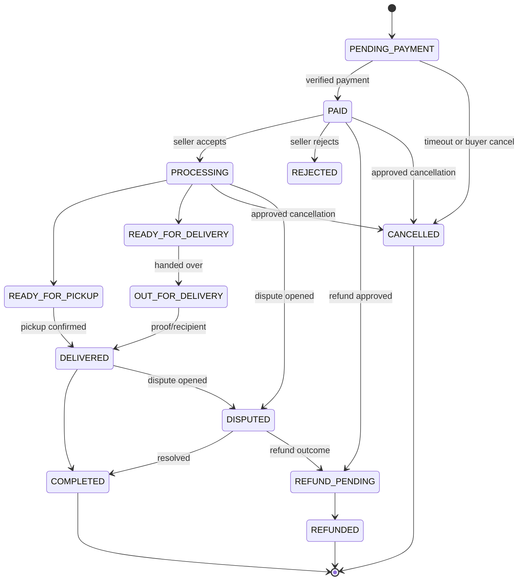
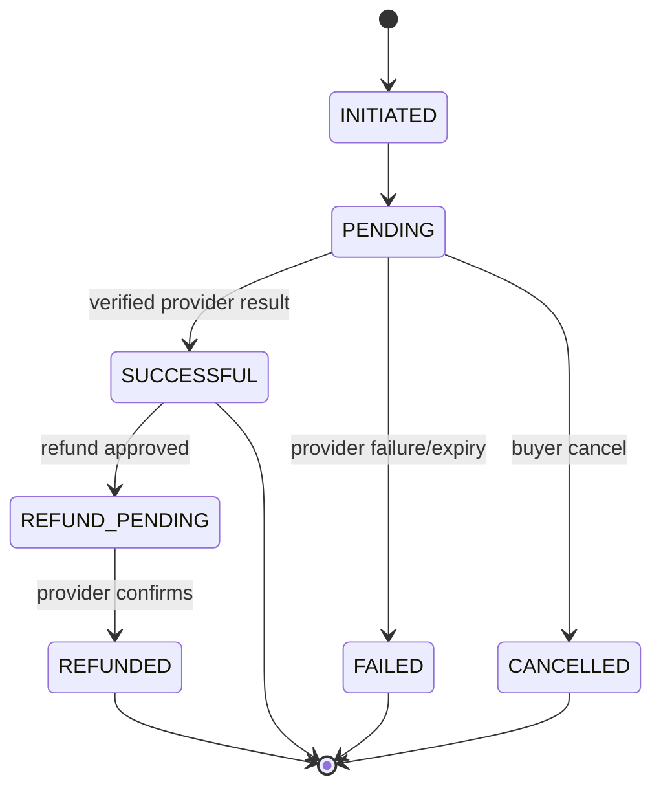
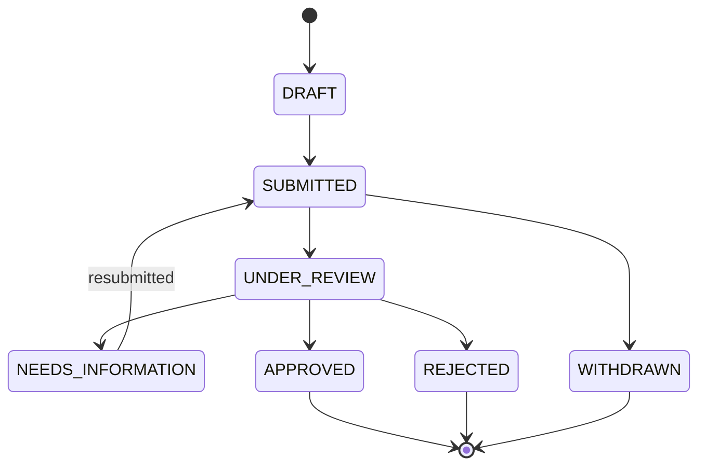
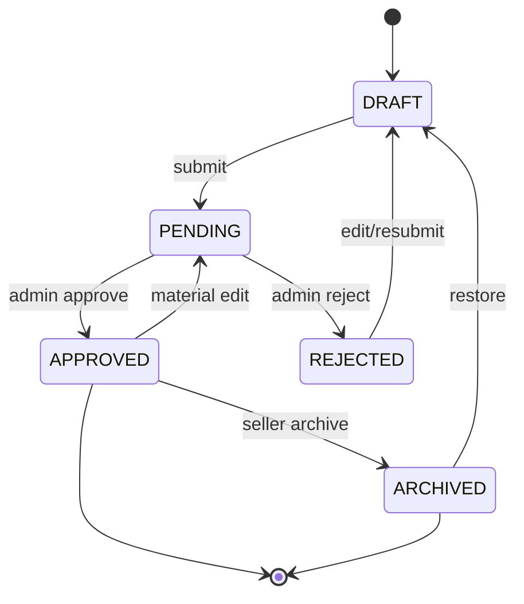

# SokoLink Software Design Document

| Attribute | Value |
| --- | --- |
| Product | SokoLink |
| Document | Software Design Document (SDD) |
| Version | Draft 1.0 |
| Date | 2026-11-17 |
| Requirements baseline | SokoLink SRS Draft 1.0 |
| Architecture | Service-oriented modular backend (current microservices retained) |
| Primary market | IFM students, with university staff as customers |
| Status | Draft for engineering approval |

## 1. Purpose and scope

This document translates the SokoLink SRS into implementable modules, service boundaries, API contracts, data ownership, transaction flows, security controls and verification criteria. It is the design baseline for implementation and testing.

The SRS recommends a modular monolith in section 6. The approved engineering decision for this baseline is to **retain the existing microservice topology**. The modular-monolith recommendation is therefore superseded for the MVP, while the domain boundaries and ownership rules from the SRS remain authoritative.

## 2. Approved business and architecture decisions

| Decision | Approved value | Design consequence |
| --- | --- | --- |
| Architecture | Keep current microservices | Gateway plus independent NestJS services; no shared databases |
| Seller eligibility | IFM students only at launch | Seller application must capture IFM student evidence and be manually reviewed |
| Seller settlement | SokoLink collects and settles to sellers | Platform receives payment; settlement ledger and payout workflow are required |
| Payment methods | Mobile money and cash on delivery | Provider-neutral payment intents plus a COD path; no card/bank requirement for MVP |
| Delivery | Campus pickup plus seller-arranged delivery | Fulfilment supports `PICKUP` and `SELLER_DELIVERY`; delivery partners are deferred |
| Customer eligibility | Students and university staff | Registration remains open, but buyer policy and campus pickup eligibility are explicit |
| Dual roles | One account can be seller and customer | Seller approval adds `SELLER` capability without creating a second identity |

### 2.1 MVP non-goals

- Live GPS tracking, automated delivery routing or distance-based delivery pricing.
- Card and bank payments, provider split payments or multi-provider automatic routing.
- AI recommendations, social feeds and complex seller analytics.
- Institutional IFM API integration; student verification is manual at launch.
- Public multi-university onboarding.
- Automated seller payouts; settlement is recorded and executed operationally.

## 3. Design principles

1. **Backend authorization is mandatory.** Hiding a button is never an access control.
2. **Every domain owns its data.** No service reads or writes another service's database.
3. **Orders and payments are one business process.** Payment, stock reservation, order state and refunds must be designed together.
4. **Multi-vendor is structural.** A single checkout creates one parent order and independent seller orders.
5. **Money uses integers.** TZS is stored as integer shillings for the MVP; multi-currency expansion uses integer minor units, never floating-point arithmetic.
6. **Historical orders are snapshots.** Prices, names and delivery details are copied into orders.
7. **Duplicate-safe by design.** Checkout, payment callbacks and event consumers are idempotent.
8. **Trust before growth.** Seller verification, payment confirmation and auditability take priority over feature count.

## 4. System context

The gateway is the public ingress. Each service still validates authentication, permissions and resource ownership. The gateway performs routing, correlation, CORS and coarse abuse controls; it is not the authorization boundary.

## 5. Service catalogue

| Service | Responsibilities | Owned data | Current status |
| --- | --- | --- | --- |
| API Gateway | Public routing, versioning, CORS, correlation, coarse rate limiting, OpenAPI ingress | No business database | Routing implemented for auth, users, seller, catalogue, inventory, orders, payment and fulfilment |
| Identity and Access | Registration, verification, login, refresh rotation, sessions, roles, permissions, MFA, audit | `identity_db` | Student/staff categories and seller eligibility projection implemented except MFA, admin user management and normalized role/permission administration |
| Seller and Verification | Seller applications, IFM student evidence, review outcomes, storefront profile, storefront status | `seller_db` | Application, IFM evidence, eligibility gate, approval/rejection and verified storefronts implemented; review history incomplete |
| Catalogue | Categories, products, variants, images, specifications, moderation, public discovery | `catalogue_db` | Implemented; variants, object storage and moderation history incomplete |
| Inventory | On-hand stock, reservations, stock ledger, reconciliation, low-stock signals | `inventory_db` | Stock ledger, reserve/release/commit implemented; reservation expiry and reconciliation incomplete |
| Commerce and Orders | Cart, checkout orchestration, parent orders, seller orders, order history, reviews, disputes | `commerce_db` | Parent/seller orders, status updates, delivery allowlist and method compatibility implemented; server cart, checkout saga, history, reviews and disputes incomplete |
| Payment | Payment methods, payment intents, provider adapters, callback validation, transaction ledger, refunds, settlements | `payment_db` | Cash/mobile-money method allowlist and payment records implemented; provider integration, callbacks, refunds and settlement ledger incomplete |
| Fulfilment | Pickup, seller delivery, partner assignment later, proof of delivery, tracking | `fulfilment_db` | Placeholder |
| Notifications | Email, in-app and SMS notifications, templates, preferences, delivery attempts | `notifications_db` | Placeholder |
| Administration and Analytics | Moderation consoles, audit index, operational reporting, platform metrics | `admin_db` projection store, planned | Logical boundary; starts as admin APIs over owning services and a future projection service |
| Delivery partner workspace | Assigned deliveries only, status updates, proof of delivery | Uses fulfilment data | Deferred until partner operations are approved |

## 6. Module design

### 6.1 Identity

- **Auth**: registration, six-digit email OTP verification, phone code verification, login, refresh rotation, logout, password recovery, change password, session listing and revocation.
- **Users**: profile read/update, account status, contact verification state.
- **Roles and permissions**: role grants, permission checks, seller grant activation after approval, admin capability configuration.
- **MFA**: TOTP or equivalent for admins; seller-sensitive-operation step-up; optional customer MFA.
- **Audit and outbox**: privileged actions and authentication events; transactional outbox for identity events.

### 6.2 Seller and verification

- **Applications**: draft, submit, resubmit, withdraw and review cycles. Capture IFM institution, student registration details, evidence references, business name, category, contact details and description.
- **Review**: explicit approve/reject/needs-information decisions with reviewer, reason and append-only history.
- **Storefront**: unique slug, business profile, logo, category, location, active/paused/suspended status.
- **Eligibility projection**: catalogue and commerce consume seller approval/status events; default deny while status is unknown.

### 6.3 Catalogue

- **Categories**: hierarchical category metadata and public counts.
- **Products**: draft, pending review, approved, rejected and archived lifecycle; seller-owned records only.
- **Variants**: optional size/colour/package variants with their own SKU, price override and availability. A product without variants uses its base price and stock item.
- **Images and specifications**: multiple images per product, ordered; image bytes are served as binary. Object storage is the production target.
- **Moderation**: admin review queue, approve/reject with reason and audit trail.
- **Discovery**: keyword search, category, seller and price filters; deterministic sorting by newest, price and recommended default.

### 6.4 Inventory

- **Stock item**: one row per sellable product or variant with `onHand`, `reserved`, low-stock threshold and unit; simple products use a default variant.
- **Stock ledger**: append-only movements for opening stock, adjustments, reservations, releases and fulfilment.
- **Reservation semantics**: reserve increases `reserved` only when `onHand - reserved >= quantity`; release decreases `reserved`; fulfilment decreases both `onHand` and `reserved`.
- **Idempotency**: movement reference plus type prevents duplicate reservation/release/commit processing.
- **Reconciliation**: target job compares stale reservations and order/payment states.

### 6.5 Commerce and orders

- **Cart**: target server-side cart keyed by buyer, with price/availability validation at checkout. Current MVP cart is browser-local and must be treated as untrusted input.
- **Checkout**: validates product snapshots, reserves stock, creates parent order and seller orders, creates payment record, and returns the order. A checkout/saga record is the target for timeout and compensation tracking.
- **Orders**: parent order belongs to the buyer; seller order belongs to exactly one seller; order items are immutable price and variant snapshots.
- **Status history**: append-only transitions with actor, reason and timestamp.
- **Reviews**: only eligible delivered purchases; one review per order item; moderation state.
- **Disputes**: customer opens against an order/seller order; seller responds; admin resolves with optional refund.

### 6.6 Payment

- **Methods**: provider-neutral method catalogue (`CASH_ON_DELIVERY`, mobile money providers, future cards).
- **Payment intent**: one payment per parent order/checkout, unique provider reference and idempotency key.
- **Provider adapters**: initiate charge, query status, validate callback signature, issue refund.
- **Transaction ledger**: immutable provider transactions and callback receipts.
- **Settlement**: platform-collected funds are allocated to sellers through settlement records after fulfillment and refund windows.
- **Invariant**: no frontend redirect can mark an order paid. Only a verified provider response or an authorized COD confirmation can do so.

### 6.7 Fulfilment

- **Methods**: campus pickup and seller-arranged delivery at launch. Partner delivery is a later extension.
- **Fulfilment record**: one per seller order with recipient, method, pickup point or delivery address, instructions and status.
- **Proof**: confirmation code, recipient confirmation, signature or photo reference.
- **Tracking**: customer-visible status; partner sees assigned records only when partner deliveries are enabled.

### 6.8 Notifications

- **Event consumers**: identity, seller, order, payment and fulfilment events.
- **Channels**: email and in-app at launch; SMS only for verification or critical events when a provider is approved.
- **Preferences and delivery attempts**: per-user channel/type preferences and retry history.

### 6.9 Administration and analytics

- **Moderation**: seller applications, products, reviews and disputes through owning-service admin APIs.
- **User management**: identity admin endpoints with explicit permissions.
- **Audit index**: event-fed projection of security and administrative actions.
- **Reporting**: daily marketplace projections; never used as the authoritative source for orders, payments or stock.

## 7. API design

### 7.1 Conventions

- Base path: `/api/v1`; OpenAPI at `/api/docs`.
- JSON requests and responses; UUID identifiers; ISO 8601 timestamps.
- Monetary values: integer TZS shillings, never floating point. Multi-currency expansion uses integer minor units or `NUMERIC(18,2)`.
- Public authentication: short-lived bearer access token; refresh token in an `HttpOnly` cookie.
- Internal service calls: `x-internal-token`; network restrictions in production.
- Every request carries or receives a correlation ID.
- Pagination: `page`, `pageSize` with bounded maximum; responses include `items`, `total`, `page`, `pageSize`, `totalPages`.
- Errors: stable `code`, human-readable `message`, optional `fieldErrors`, `correlationId`.
- Idempotency: checkout requests require a client key; payment callbacks and event consumers deduplicate by provider/event ID.

### 7.2 Public and authenticated endpoint catalogue

| Area | Method and path | Access | Purpose | Status |
| --- | --- | --- | --- | --- |
| Auth | `POST /auth/register` | Public | Register customer | Implemented |
| Auth | `POST /auth/login` | Public | Sign in and set refresh cookie | Implemented |
| Auth | `POST /auth/refresh` | Cookie | Rotate refresh session | Implemented |
| Auth | `POST /auth/logout` | Cookie | Revoke current session | Implemented |
| Auth | `POST /auth/logout-all` | Bearer | Revoke all sessions | Implemented |
| Auth | `GET /auth/sessions` | Bearer | List active sessions | Implemented |
| Auth | `DELETE /auth/sessions/:id` | Bearer | Revoke owned session | Implemented |
| Auth | `POST /auth/change-password` | Bearer | Change password and revoke sessions | Implemented |
| Auth | `POST /auth/verify-email` | Public | Verify six-digit email OTP | Implemented |
| Auth | `POST /auth/resend-email-verification` | Public | Issue a new email OTP and invalidate outstanding codes | Implemented |
| Auth | `POST /auth/forgot-password` | Public | Request reset | Implemented |
| Auth | `POST /auth/reset-password` | Public | Reset password | Implemented |
| Auth | `GET /auth/me` | Bearer | Current account | Implemented |
| Auth | `POST /auth/phone/request` | Bearer | Send phone code | Implemented |
| Auth | `POST /auth/phone/verify` | Bearer | Verify phone | Implemented |
| Users | `GET /users/me` | Bearer | Profile | Implemented |
| Users | `PATCH /users/me` | Bearer | Update profile | Implemented |
| Seller | `GET /seller/storefronts` | Public | List active storefronts | Implemented |
| Seller | `GET /seller/storefronts/:slug` | Public | Public storefront | Implemented |
| Seller | `GET /seller/storefronts/:id/logo` | Public | Storefront logo | Implemented |
| Seller | `POST /seller/applications` | Bearer | Submit or resubmit application | Implemented |
| Seller | `GET /seller/applications/me` | Bearer | Own application and storefront | Implemented |
| Seller | `GET /seller/profile` | Seller | Own storefront profile | Implemented |
| Seller | `PUT /seller/profile` | Seller | Create or update storefront | Implemented |
| Seller | `GET /seller/admin/applications` | Admin | Review queue | Implemented |
| Seller | `POST /seller/admin/applications/:id/approve` | Admin | Approve and grant seller | Implemented |
| Seller | `POST /seller/admin/applications/:id/reject` | Admin | Reject with reason | Implemented |
| Catalogue | `GET /catalogue/categories` | Public | Categories and counts | Implemented |
| Catalogue | `GET /catalogue/products` | Public | Search and browse | Implemented |
| Catalogue | `GET /catalogue/products/:id` | Public | Product by id or slug | Implemented |
| Catalogue | `GET /catalogue/products/:id/related` | Public | Related products | Implemented |
| Catalogue | `GET /catalogue/images/:id` | Public | Binary product image | Implemented |
| Catalogue | `GET /catalogue/seller/products` | Seller | Own products | Implemented |
| Catalogue | `GET /catalogue/seller/products/:id` | Seller | Own product | Implemented |
| Catalogue | `GET /catalogue/seller/stats` | Seller | Product counts | Implemented |
| Catalogue | `POST /catalogue/seller/products` | Seller | Create draft + opening stock | Implemented |
| Catalogue | `POST /catalogue/seller/products/:id` | Seller | Update product | Implemented |
| Catalogue | `POST /catalogue/seller/products/:id/submit` | Seller | Submit for review | Implemented |
| Catalogue | `POST /catalogue/seller/products/:id/archive` | Seller | Archive | Implemented |
| Catalogue | `POST /catalogue/seller/products/:id/restore` | Seller | Restore to draft | Implemented |
| Catalogue | `POST /catalogue/seller/products/:id/images` | Seller | Add image | Implemented |
| Catalogue | `DELETE /catalogue/seller/products/:id/images/:imageId` | Seller | Remove image | Implemented |
| Catalogue | `GET /catalogue/admin/products` | Admin | Moderation queue | Implemented |
| Catalogue | `POST /catalogue/admin/products/:id/approve` | Admin | Approve product | Implemented |
| Catalogue | `POST /catalogue/admin/products/:id/reject` | Admin | Reject product | Implemented |
| Inventory | `GET /inventory/seller/items` | Seller | Own stock | Implemented |
| Inventory | `GET /inventory/seller/items/:productId/movements` | Seller | Movement history | Implemented |
| Inventory | `POST /inventory/seller/items/:productId/adjust` | Seller | Adjust stock | Implemented |
| Inventory | `PATCH /inventory/seller/items/:productId/settings` | Seller | Threshold/unit | Implemented |
| Commerce | `POST /orders` | Buyer | Multi-seller checkout | Implemented |
| Commerce | `GET /orders` | Buyer | Own orders | Implemented |
| Commerce | `GET /orders/:id` | Buyer | Own order detail | Implemented |
| Commerce | `GET /orders/seller` | Seller | Own seller orders | Implemented |
| Commerce | `GET /orders/seller/stats` | Seller | Seller order counts | Implemented |
| Commerce | `GET /orders/seller/:id` | Seller | Own seller order | Implemented |
| Commerce | `PATCH /orders/seller/:id/status` | Seller | Advance or cancel suborder | Implemented |
| Payment | `GET /payment/methods` | Public | Enabled methods | Implemented |
| Payment | `GET /payment/payments/:orderId` | Buyer/Admin | Payment detail | Implemented |
| Commerce | `GET/POST/PATCH /cart` | Buyer | Server-side cart | Planned |
| Commerce | `POST /checkout` | Buyer | Checkout/saga orchestration | Planned |
| Commerce | `GET /orders/:id/history` | Buyer/Admin | Status history | Planned |
| Commerce | `POST /orders/:id/reviews` | Buyer | Review eligible purchase | Planned |
| Commerce | `POST /orders/:id/disputes` | Buyer | Open dispute | Planned |
| Payment | `POST /payment/intents` | Buyer | Start mobile-money payment | Planned |
| Payment | `POST /payment/callbacks/:provider` | Provider | Verified callback | Planned |
| Payment | `POST /payment/refunds` | Admin | Refund workflow | Planned |
| Fulfilment | `GET/POST/PATCH /fulfilment` | Buyer/Seller/Admin | Pickup, delivery, tracking | Planned |
| Notifications | `GET /notifications`, `PATCH /notifications/preferences` | Bearer | Inbox and preferences | Planned |
| Admin | `/admin/users`, `/admin/audit`, `/admin/analytics` | Admin | Platform operations | Planned |

### 7.3 Internal contracts

Internal endpoints are not exposed to browsers and require `x-internal-token`. They are time-bounded and idempotent where they mutate state.

| Route | Caller | Purpose |
| --- | --- | --- |
| `POST /identity/internal/users/:id/roles` | Seller | Grant `SELLER` after approval |
| `GET /seller/internal/users/:id/summary` | Catalogue | Resolve seller display name and storefront |
| `POST /catalogue/internal/products/batch` | Commerce | Fetch approved product snapshots |
| `POST /inventory/internal/initialize` | Catalogue | Opening stock |
| `POST /inventory/internal/levels` | Catalogue | Batch stock levels |
| `POST /inventory/internal/reserve` | Commerce | Reserve checkout stock |
| `POST /inventory/internal/release` | Commerce | Release stock on failure/cancel |
| `POST /inventory/internal/commit` | Commerce | Commit stock on delivery |
| `POST /payment/internal/validate-method` | Commerce | Validate method |
| `POST /payment/internal/payments` | Commerce | Create payment record |

### 7.4 Event catalogue

| Event | Producer | Consumers | Purpose |
| --- | --- | --- | --- |
| `UserRegistered` | Identity | Notifications, Admin | Welcome/verification, metrics |
| `ContactVerified` | Identity | Seller, Notifications | Eligibility and messaging |
| `RoleGranted` | Identity | Catalogue, Seller, Admin | Seller capability propagation |
| `SellerApplicationSubmitted` | Seller | Notifications, Admin | Review queue |
| `SellerApproved` | Seller | Identity, Catalogue, Notifications, Admin | Grant seller and enable listing |
| `SellerRejected` | Seller | Notifications, Admin | Applicant feedback |
| `StorefrontChanged` | Seller | Catalogue, Admin | Storefront projection |
| `ProductSubmitted` | Catalogue | Admin | Moderation queue |
| `ProductApproved` | Catalogue | Search projections, Admin | Public availability |
| `ProductRejected` | Catalogue | Notifications, Admin | Seller feedback |
| `ProductArchived` | Catalogue | Search projections | Remove from public catalogue |
| `StockReserved` | Inventory | Commerce, Admin | Reservation audit |
| `StockReservationReleased` | Inventory | Commerce | Compensation trace |
| `StockCommitted` | Inventory | Commerce | Fulfilment trace |
| `LowStock` | Inventory | Notifications, Seller | Seller alert |
| `OrderPlaced` | Commerce | Payment, Notifications, Admin | Order created |
| `OrderPaid` | Commerce | Inventory, Fulfilment, Notifications, Admin | Paid order ready to process |
| `OrderStatusChanged` | Commerce | Notifications, Admin, Fulfilment | Customer/seller tracking |
| `OrderCancelled` | Commerce | Payment, Inventory, Notifications | Compensation |
| `PaymentInitiated` | Payment | Commerce, Notifications | Awaiting provider |
| `PaymentSucceeded` | Payment | Commerce, Notifications, Admin | Verified payment only |
| `PaymentFailed` | Payment | Commerce, Notifications | Retry/cancel path |
| `RefundUpdated` | Payment | Commerce, Notifications, Admin | Refund state |
| `SettlementPaid` | Payment | Seller, Admin | Seller payout record |
| `FulfilmentCreated` | Fulfilment | Commerce, Notifications | Pickup/delivery job |
| `FulfilmentStatusChanged` | Fulfilment | Commerce, Notifications | Tracking |
| `FulfilmentDelivered` | Fulfilment | Commerce, Notifications | Completion trigger |
| `ReviewPublished` | Commerce | Catalogue, Admin | Ratings projection |
| `DisputeOpened` / `DisputeResolved` | Commerce | Admin, Payment, Notifications | Support workflow |

All events use a stable envelope: `id`, `type`, `version`, `occurredAt`, `producer`, `correlationId`, `causationId`, payload. Consumers deduplicate by event ID and acknowledge only after local commit.

## 8. Authorization model

Roles are grants; permissions are backend checks; ownership is evaluated per resource.

| Capability | Customer | Seller | Delivery partner | Admin | Superadmin |
| --- | --- | --- | --- | --- | --- |
| Browse public catalogue | Yes | Yes | Yes | Yes | Yes |
| Manage own profile and sessions | Yes | Yes | Yes | Yes | Yes |
| Submit own seller application | Yes | Yes | No | No | No |
| Review seller applications | No | No | No | Yes, if permitted | Yes |
| Manage own storefront/products/inventory | No | Yes, own only | No | Moderate only | Audited override |
| Place and view own orders | Yes | Yes | No | Restricted support view | Restricted audited view |
| Process seller orders | No | Own seller orders | No | Oversight only | Audited override |
| Update assigned delivery | No | Own delivery | Assigned only | Oversight | Audited override |
| View platform analytics | Own activity | Own business | Own assignments | Yes, if permitted | Yes |
| Manage administrators/roles | No | No | No | No | Yes |

Rules:

- Seller permissions activate only after an explicit approved application.
- Suspended or disabled accounts cannot perform protected operations.
- A seller cannot read or mutate another seller's product, stock, order or buyer details by changing an ID.
- A customer cannot read another customer's order or payment.
- A delivery partner can only access assigned fulfilments.
- Admin capabilities are explicit permissions, not an all-or-nothing role.
- Every privileged action records actor, action, target, timestamp and correlation ID.

## 9. Key workflows

### 9.1 Student becomes a seller

1. Student registers, enters the six-digit email OTP and verifies email.
2. Student submits an application with IFM student evidence and storefront details.
3. Seller service stores the application as submitted and emits `SellerApplicationSubmitted`.
4. Admin reviews and approves or rejects with a reason.
5. On approval, seller service creates/updates the storefront and calls identity to grant `SELLER`.
6. Identity emits `RoleGranted`; catalogue enables product publication for that seller.
7. Seller creates a draft product and submits it for moderation.
8. Admin approves the product; it becomes publicly discoverable.

### 9.2 Multi-seller checkout

1. Buyer submits cart items, delivery details, payment method and idempotency key.
2. Commerce fetches approved product snapshots from Catalogue.
3. Commerce validates the payment method with Payment.
4. Commerce reserves stock with Inventory using the order reference.
5. Commerce creates one parent order, one seller order per seller and immutable item snapshots.
6. Commerce creates a payment record/intent for the parent order.
7. Commerce emits `OrderPlaced`.
8. For prepaid mobile money, the order waits for verified payment. For COD, the order can proceed to seller confirmation with payment status `PENDING`.
9. Each seller manages only their own seller order.

If any step fails, Commerce releases reserved stock and returns a structured error. Repeated submissions with the same idempotency key return the original order rather than creating a duplicate.

### 9.3 Payment confirmation

1. Provider sends a callback to Payment.
2. Payment validates signature/authentication, timestamp/replay controls, reference, amount and currency.
3. Payment stores the callback receipt and deduplicates it.
4. Payment queries the provider when required by provider semantics.
5. Payment records an immutable transaction and moves the payment to `SUCCESSFUL`.
6. Payment emits `PaymentSucceeded`.
7. Commerce marks the parent order paid, records status history and emits `OrderPaid`.
8. Notifications informs buyer and sellers; fulfilment becomes ready.

Browser redirects are display-only. A redirect, query string or frontend message never marks an order paid.

### 9.4 Fulfilment

1. Commerce creates a fulfilment record per seller order after payment or COD confirmation.
2. The record is `PICKUP` or `SELLER_DELIVERY`.
3. Seller marks it ready, then handed over/out for delivery.
4. Pickup is confirmed by the seller or a pickup code.
5. Delivery is confirmed with proof or recipient confirmation.
6. Commerce receives `FulfilmentDelivered`, marks the seller order delivered, commits stock and eventually completes the order.

### 9.5 Reviews and disputes

- A review is allowed only for a delivered order item owned by the buyer; one review per item.
- Reviews enter a moderation state before or after publication according to policy.
- A dispute can be opened by the buyer against a seller order within the policy window.
- Seller can respond; admin resolves with no action, replacement, cancellation or refund.
- A refund outcome invokes the payment refund workflow; the dispute references the refund.

### 9.6 Notifications

- Notifications consume domain events; they never become the source of truth for order/payment state.
- Email and in-app are launch channels. SMS is limited to verification and critical order events.
- Delivery failures are retried with bounded backoff and recorded.

## 10. State machines

### 10.1 Order and seller order

COD exception: a COD order may move from `PENDING_PAYMENT`/`PLACED` to seller processing while payment remains `PENDING`; payment becomes `PAID` only when cash is confirmed. The order cannot reach `COMPLETED` with an unsettled COD payment unless an authorized bad-debt exception is recorded.

### 10.2 Payment

### 10.3 Seller application

### 10.4 Product

## 11. Data consistency and transactions

- Each service uses a local database transaction for its own state and outbox row.
- RabbitMQ delivery is at least once; consumers use an inbox/deduplication table.
- Checkout is an orchestrated saga. The target checkout record stores step status, timeout and compensation state.
- Stock reservations are reference-based and idempotent. A reservation expiry job releases stale reservations.
- Payment callbacks are idempotent by provider callback ID and payment reference.
- Order items and payment amounts are immutable snapshots.
- Parent order status is recomputed from seller order states using explicit rules.
- Refunds create a new transaction; they never mutate the original successful transaction.
- Settlement records are derived from delivered seller orders minus refunds, commission and adjustments.
- Reconciliation jobs detect stuck payments, orphan payments, stale reservations and order/payment mismatches.

## 12. Security design

- Argon2id password hashing; no plaintext passwords.
- Short-lived access tokens; hashed, rotating, revocable refresh tokens; reuse detection.
- Mandatory MFA for admins and superadmins; seller step-up for sensitive changes; optional customer MFA.
- Backend permission and ownership checks for every resource operation.
- Explicit admin permissions; superadmin is exceptional and audited.
- Payment secrets only server-side; callbacks authenticated, replay-protected and deduplicated.
- Input validation, output encoding, parameterized queries, upload size/type limits and safe error responses.
- Student evidence stored by reference in restricted storage; never broadcast in events or logs.
- Audit logs for seller decisions, role changes, moderation, payment/refund adjustments and privileged access.
- Secrets never committed; local `.env` is development-only.
- Rate limits on registration, login, verification, checkout, recovery and callbacks.
- Registration email OTPs are six digits, bound to the verification record by HMAC, single-use, limited to five attempts and invalidated when a new code is issued. Password reset remains an opaque single-use token.

## 13. Non-functional design

| Area | Design response |
| --- | --- |
| API performance | Indexed queries, bounded pagination, projections, no unbounded lists |
| Search | PostgreSQL keyword search initially; dedicated search engine only when justified |
| Images | Compressed images; object storage/CDN target; binary streaming with cache headers |
| Availability | Health/readiness endpoints, retries with backoff, idempotency, outbox, DLQ |
| Consistency | Local transactions, saga compensation, reconciliation jobs |
| Scalability | Stateless services; scale gateway, catalogue, commerce and payment independently |
| Observability | Structured logs, correlation IDs, metrics, queue depth, payment age, outbox backlog |
| Recovery | Per-database backups, restore drills, documented RPO/RTO before production |
| Compatibility | Current Chrome, Firefox, Edge and Safari; Android/iOS browsers |
| Accessibility | Semantic forms, labels, keyboard navigation, visible validation, responsive layouts |
| Privacy | Data minimization, restricted student evidence, retention/deletion policy, redacted logs |

## 14. Deployment and operations

- Local: Docker Compose with PostgreSQL, RabbitMQ, gateway, services and web.
- Production: gateway/load balancer, independently deployed services, managed PostgreSQL or isolated databases, managed broker, secret manager, TLS, backups, centralized logs/metrics/traces.
- Each service runs its own forward-only migrations.
- Environment configuration is externalized; no production secrets in images or source control.
- Database roles are least-privilege and service-specific.
- Health checks: liveness avoids dependencies; readiness checks essential dependencies.
- Deployments use backward-compatible migrations and contract versioning.

## 15. Testing and acceptance

| Level | Scope |
| --- | --- |
| Unit | Services, state transitions, pricing, permissions, validation |
| Integration | Database constraints, Prisma migrations, outbox/inbox, provider adapters |
| Contract | Gateway-to-service routes and service-to-service internal APIs |
| API | Endpoint status codes, validation and error shapes |
| Authorization | Role, ownership and seller/order isolation tests |
| Security | IDOR, fake payment, replay, price manipulation, stock abuse, suspended actors |
| Performance | Response targets, concurrent checkout and search load |
| End-to-end | Seller onboarding, product publish, multi-seller purchase, payment, fulfilment |
| Regression | Existing identity, catalogue and order flows after each phase |

Mandatory negative tests:

- Seller A cannot read or modify Seller B's products, stock or orders.
- Customer A cannot read Customer B's order or payment.
- Unapproved seller cannot publish a product.
- Suspended seller cannot list or receive new orders.
- Delivery partner cannot access an unassigned fulfilment.
- Buyer-submitted "payment success" cannot mark an order paid.
- Duplicate payment callback produces one transaction and one state transition.
- Manipulated product price in the checkout request is ignored in favor of the server snapshot.
- Quantity greater than available stock is rejected.
- Admin without a specific permission cannot perform that operation.

## 16. Requirement traceability

| SRS group | Design sections | Owning services |
| --- | --- | --- |
| FR-AUTH-001..012 | 6.1, 8, 9.1, 12 | Identity, Gateway, Web |
| FR-SELL-001..010 | 6.2, 8, 9.1, 10.3 | Seller, Identity, Catalogue |
| FR-PROD-001..013 | 6.3, 8, 9.1, 10.4 | Catalogue, Inventory, Seller |
| FR-CART-001..012 | 6.5, 8, 9.2, 11 | Commerce, Catalogue, Inventory, Payment |
| FR-ORDER-001..010 | 6.5, 8, 9.2, 9.4, 10.1 | Commerce, Fulfilment, Notifications |
| FR-PAY-001..012 | 6.6, 8, 9.3, 10.2, 11 | Payment, Commerce |
| FR-DEL-001..010 | 6.7, 8, 9.4 | Fulfilment, Commerce |
| FR-REV-001..005 | 6.5, 9.5 | Commerce, Catalogue, Admin |
| FR-NOT-001..007 | 6.8, 7.4, 9.6 | Notifications |
| FR-ADMIN-001..012 | 6.9, 8, 12 | Gateway/Admin, Identity, Seller, Catalogue, Commerce, Payment |
| FR-DISP-001..005 | 6.5, 9.5 | Commerce, Payment, Admin |
| NFR-PER | 13 | All services |
| NFR-SEC | 12 | All services |
| NFR-REL | 11, 13 | All services |
| BR-001..014 | 5, 8, 9, 10, 11 | Owning services |
| Workflows A-D | 9.1..9.4 | Cross-service |

## 17. Implementation status and gaps

| Area | Implemented baseline | Required next work |
| --- | --- | --- |
| Identity | Registration with student/staff categories, verification, login, refresh rotation, password recovery, RBAC, sessions, audit, internal seller eligibility projection | MFA, admin user management, account status/admin actions, normalized permission administration |
| Seller | IFM evidence application, identity eligibility gate, approval/rejection, role grant, verified storefront, logo | Review cycles/history, suspension effects, resubmission audit |
| Catalogue | Categories, products, images, specs, moderation, search/filter, related products | Variants, seller-status enforcement, object storage, moderation history, condition/in-stock server filters |
| Inventory | Opening stock, adjustments, reserve/release/commit, movement ledger | Reservation expiry, reconciliation, low-stock events, stock projections |
| Commerce | Parent order, seller orders, item snapshots, idempotency, seller status transitions, `PICKUP`/`SELLER_DELIVERY` allowlist, payment/delivery compatibility | Server cart, checkout saga record, status history, target order states, delivery fees, reviews, disputes, admin monitoring |
| Payment | Cash/mobile-money method allowlist, payment record, COD seed, buyer payment view, platform settlement wording | Provider adapters, intent initiation, callbacks, transaction ledger, refunds, reconciliation, settlement ledger |
| Fulfilment | Placeholder | Pickup/delivery records, seller flow, proof, tracking, admin oversight |
| Notifications | Placeholder | Event consumers, email/in-app, preferences, delivery attempts |
| Admin/analytics | Protected placeholder pages plus service admin endpoints | Projection store, audit index, reporting, explicit admin permissions |
| Gateway | Routing for auth, users, seller, catalogue, inventory, orders, payment, fulfilment | Notifications route, rate limiting, abuse controls, production TLS integration |

Known design deviations from the current code:

- Current order states are a subset of the target state machine and must be migrated or explicitly mapped.
- Current cart is browser-local; checkout must revalidate all prices and stock on the server.
- Current payment records do not include provider transactions or callbacks.
- Current seller profile doubles as the storefront; the target may split profile and storefront if operations require it.
- Current role grants use an enum in `UserRole`; the target ERD normalizes roles/permissions.

## 18. Risks and open items

- Mobile-money provider onboarding, sandbox access and callback behavior are not finalized.
- Seller commission rate, settlement timing and payout ownership must be approved.
- Refund, cancellation and dispute windows must be approved.
- IFM student evidence format, verification method and retention period must be approved.
- Delivery fee formula and who pays for seller-arranged delivery must be approved.
- MFA enforcement details for sellers and delivery partners must be finalized.
- SMS provider selection and cost policy must be finalized.
- Search quality may require a dedicated engine once catalogue volume grows.
- Microservice operations add tracing, deployment and data-consistency overhead; keep service boundaries disciplined.
- COD introduces collection risk and requires seller confirmation and reconciliation controls.

## 19. Change control

Changes to approved business decisions require an update to this SDD and, where architectural, a new or superseding ADR. The SRS remains the requirements baseline; this document records how the approved requirements are implemented. The microservice deviation is recorded in [ADR-006](ADR/ADR-006-retain-microservices.md).
